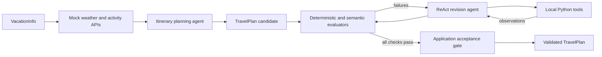

# Travel Planning Agent

Travel Planning Agent is a constraint-aware itinerary planning and revision
workflow built with structured LLM outputs, Python validation, semantic
evaluators, and a tool-using repair loop.

Given traveler preferences, trip dates, a shared budget, weather forecasts, and
an authoritative activity catalog, the system produces a typed `TravelPlan`,
checks it against business rules, incorporates later traveler feedback, and
accepts the revised plan only after an independent final evaluation.

The important engineering problem is not free-form travel recommendation. It is
controlling an LLM inside a decision workflow where source integrity,
arithmetic, scheduling, user preferences, and acceptance criteria remain
inspectable.

## Business problem and success criteria

The fictional travelers, Yuri and Hiro, visit AgentsVille from 2025-06-10
through 2025-06-12 with a shared budget of 130 currency units. Both travelers
follow one group itinerary; an activity appears once even when one traveler's
interests primarily motivate the selection.

The workflow targets the following requirements:

- cover every date in the inclusive trip interval;
- use only authoritative activities available on the correct date;
- represent every traveler's individual interests across the shared itinerary;
- avoid weather-incompatible activities unless the source description provides
  a suitable backup;
- prevent same-day activity times from overlapping;
- calculate the exact activity total and remain within the shared budget; and
- incorporate later feedback requesting at least two activities per day.

The architecture is transferable beyond travel. The same
proposal → validation → repair → acceptance pattern can support scheduling,
quoting, procurement, claims review, and other workflows in which an LLM
recommends an action but application code owns factual retrieval and acceptance.

## System architecture



The workflow has two model-driven stages and one application-owned gate:

1. **Initial planning.** The system prompt embeds the serialized
   `VacationInfo`, weather records, activity records, and `TravelPlan` schema in
   its Context section. The same `VacationInfo` is also sent as the user
   message. The model returns JSON that Python validates as `TravelPlan`.
2. **Evaluation and revision.** Evaluators return actionable failures. A
   text-based ReAct agent requests one local tool at a time, receives the
   Python-generated observation, carries the complete candidate forward, and
   iterates toward a passing plan.
3. **Independent acceptance.** After the loop returns `travel_plan_2`, Python
   runs the complete evaluator suite again and raises if any requirement fails.

## Runtime data flow

One ReAct turn follows this sequence:

```text
Python sends system instructions + current message history
        ↓
LLM returns THOUGHT + ACTION JSON as text
        ↓
Python parses ACTION, resolves tool_name, and executes tool_fn(**arguments)
        ↓
Python appends the tool result as OBSERVATION
        ↓
The next model request receives the updated history
```

The API call is synchronous. `ACTION:` is not a signal emitted into the Python
runtime; it is a text delimiter that Python looks for after the complete model
response has returned.

## LLM and Python responsibilities

> The LLM proposes plans, semantic judgments, and tool requests. Python owns
> authoritative data access, function execution, schema validation, arithmetic,
> evaluation, conversation state, and the final acceptance gate.

| Component | Responsibility | Boundary |
|---|---|---|
| `travel_planning.ipynb` | Defines domain models, prompts, evaluators, exposed tools, text-action parsing, the revision loop, and the post-loop acceptance gate | It relies on the support module for mocked records and generic chat transport |
| `project_lib.py` | Supplies the chat wrapper, mocked weather and activity records, interest enum, formatting helpers, and optional narration support | It does not choose tools, revise a plan, or decide whether a completed plan is acceptable |
| LLM | Creates candidate plans, interprets natural-language weather compatibility, evaluates traveler feedback, and selects the next requested tool | It cannot directly invoke local functions or inspect Python memory |
| Python application | Parses model output, executes functions, retrieves authoritative records, calculates totals, validates Pydantic objects, records observations, limits the loop, and performs final evaluation | It does not treat confident model prose as proof that a hard rule passed |

`project_lib.py` is therefore important even though it is supplied
infrastructure. `ChatAgent.reset()` places the complete system prompt in the
message list, and `ChatAgent.get_response()` sends that list to the
Chat Completions-compatible endpoint. The notebook's `run_react_cycle()` owns
the domain-specific orchestration after each response returns.

## Data contracts

Pydantic models make the interface between the LLM and Python explicit:

- `Traveler` contains one person's identity, age, and interests.
- `VacationInfo` contains the travelers, destination, inclusive date range,
  and group budget.
- `Weather` represents the authoritative forecast for one date.
- `Activity` represents one complete authoritative catalog record.
- `ActivityRecommendation` keeps catalog facts separate from the model's
  recommendation reasons.
- `ItineraryDay` groups a date, its weather, and selected recommendations.
- `TravelPlan` is the final machine-validated object containing the city, trip
  boundaries, total cost, and daily itinerary objects.

The model does not return the schema itself. It must return an instance whose
fields and nested values validate against the schema. This prevents plausible
prose or partial JSON from silently entering downstream logic.

## Constraint and evaluation coverage

The project combines deterministic checks with semantic LLM checks:

| Evaluation | Owner | Purpose |
|---|---|---|
| Trip boundaries | Python | Confirms the requested arrival and departure dates |
| Total-cost accuracy | Python | Recomputes the sum of selected activity prices |
| Activity-record integrity | Python + mocked API | Detects missing, invented, paraphrased, or altered catalog records |
| Interest coverage | Python | Confirms every traveler receives at least one interest match |
| Budget compliance | Python | Enforces the maximum group budget |
| Weather compatibility | LLM evaluator | Interprets indoor/outdoor descriptions and explicit backup options |
| Traveler-feedback incorporation | LLM evaluator | Judges whether the revision contains at least two activities per day |

This split reflects a general design principle: exact facts, identifiers,
arithmetic, and schemas belong in deterministic code; natural-language
interpretation can use a model when the decision boundary is genuinely
semantic. Model-based checks remain bounded by an enum contract and are backed
by the final application-side evaluation.

## CoT and ReAct: repository pattern versus modern practice

Chain-of-Thought prompting and ReAct are not interchangeable. CoT decomposes a
single decision; ReAct alternates reasoning, requested actions, and external
observations. Neither concept is simply obsolete. What has changed is how much
process must be written into the prompt and how tool calls are represented.

| Dimension | Explicit CoT: repository pattern | Modern reasoning workflow | Text ReAct: repository pattern | Modern tool-using workflow |
|---|---|---|---|---|
| Primary purpose | Decompose one constrained planning response | Define the outcome, evidence, constraints, success criteria, and output contract while allowing the model to choose an efficient reasoning path | Alternate model decisions with external observations until a valid plan is produced | Use native tool calls and application-managed state to gather data, take actions, and validate results |
| Prompt style | Detailed planning steps plus a visible, concise `ANALYSIS` section | Outcome-first, direct instructions; prescribe individual steps only when the process itself is a requirement | Require exactly one textual `THOUGHT` and one textual `ACTION` JSON object per turn | Supply tools as API-level definitions with typed JSON Schemas and concise descriptions |
| Reasoning surface | The model reports a checklist-style decision summary before the final JSON | Request only the explanation or decision summary needed by the user or audit process; the model can reason internally | The model writes a short rationale before every requested action | A concise user-visible preamble is optional; a custom `THOUGHT:` delimiter is unnecessary |
| Output contract | A fenced JSON block is extracted and validated with Pydantic | Structured Outputs can enforce a response schema at the API boundary | Tool names, argument rules, and examples are embedded in system-prompt text | Function tools are passed separately from messages and can use strict argument schemas |
| Tool invocation | None during the initial response | Structured output can be combined with later application validation | Python searches ordinary text for `ACTION:` and repairs/parses the following JSON | The API returns a structured tool-call item with a tool name, arguments, and call identifier |
| Tool execution | Not applicable until generation completes | Application code owns all real side effects | Python maps `tool_name` to a local function and calls `tool_fn(**arguments)` | Application code executes the requested function and returns a linked tool result |
| State | All planning facts are supplied in prompt context | Conversation or response state can retain relevant context | Python manually appends `OBSERVATION` to chat history | Responses API state or explicitly replayed response/tool items carry the workflow forward |
| Completion | One Pydantic-valid `TravelPlan` is returned | Structured output plus application-side rules define acceptance | The prompt tells the model when to request `final_answer_tool` | The application enforces stopping rules and final acceptance independently of the model's claim |
| Role here | Produces the initial itinerary | Recommended evolution for a production planner | Revises the itinerary after feedback and evaluator failures | Recommended evolution for replacing handwritten action parsing |
| Current status | Useful when a specific reasoning procedure or user-facing decision summary is required | Usually preferable for capable reasoning models because it avoids unnecessary process micromanagement | The reason–act–observe concept remains useful and inspectable | Native function calling replaces the fragile text protocol, not the need for orchestration |

Current official OpenAI guidance recommends simple, direct prompts for
reasoning models and notes that explicit “think step by step” instructions can
be unnecessary. It also defines function calling as an API-level interface in
which tools use typed schemas, models return structured calls, applications
execute the real functions, and applications return the tool results. This
project intentionally retains the visible text protocols required by its
learning objectives while documenting how the same architecture would evolve.

## Text-based ReAct mechanics

The model sees a response template such as:

````text
THOUGHT:
I need to evaluate the complete candidate before deciding what to revise.

ACTION:
{"tool_name": "run_evals_tool", "arguments": {"travel_plan": {"...": "complete TravelPlan"}}}
````

The angle-bracketed placeholders in the actual prompt are instructions to the
model, not values that a developer fills manually at runtime. Each turn works
as follows:

1. `ChatAgent` sends the system prompt, original plan, and accumulated history.
2. The LLM chooses a tool and fills the JSON arguments using the current plan
   and latest observation.
3. The synchronous API call returns one ordinary text string.
4. `run_react_cycle()` extracts the payload after `ACTION:` and parses it.
5. Python matches `tool_name` against `ALL_TOOLS` and executes the real function.
6. Python appends the function result as an `OBSERVATION` user message.
7. The next model request receives that history and chooses the next action.

Within `run_react_cycle()`, `final_answer_tool` is a protocol-level stop signal.
When the model requests that tool, Python validates `final_output` as a
`TravelPlan` and returns it from the loop.

The system prompt requires that object to be identical to the candidate from
the immediately preceding successful `run_evals_tool` call. The loop does not,
however, persist and compare those two objects programmatically. Trust is closed
after the loop by the independent acceptance gate, which runs the complete
evaluator suite on `travel_plan_2` and raises if any evaluation fails. A
production implementation could additionally retain a canonical serialization
or hash of the last passing candidate and reject a different final submission.

## Repository structure

```text
.
├── travel_planning.ipynb          # Source-clean, completed workflow notebook
├── project_lib.py                 # Udacity-provided support and mocked data
├── docs/
│   └── rubric-alignment.md        # Criterion-by-criterion evidence map
├── scripts/
│   └── validate_notebook.py       # Deterministic offline contract checks
├── .env.example                   # Environment-variable template
├── pyproject.toml                 # Locked project metadata and dependencies
├── uv.lock                        # Exact dependency resolution
└── README.md
```

The output-bearing notebook used for the successful Udacity submission is
retained separately in local `Archive.zip`. The archive is intentionally
excluded from version control so the GitHub review surface does not include
large prompt dumps or stochastic model traces.

## Setup and execution

The repository targets Python 3.13 and uses `uv` for dependency management.

```bash
uv sync --locked
cp .env.example .env
```

Set `OPENAI_API_KEY` in `.env`. The downloaded Udacity environment uses a
Vocareum-compatible endpoint; set `OPENAI_BASE_URL` to another compatible
endpoint if required.

Select the resulting environment as the Jupyter kernel and run
`travel_planning.ipynb` from top to bottom. The optional narrative cell can make
an additional text-generation and speech call, but it is not part of planning,
revision, or acceptance. Model calls are stochastic and may consume paid or
course-provided API capacity.

Run the deterministic repository check without making API calls:

```bash
uv run python scripts/validate_notebook.py
```

## Verification status

The project passed the Udacity rubric review. In the archived passing execution,
the post-ReAct application gate returned `success=True` with `failures=[]`
across all seven evaluations. The accepted itinerary scheduled 3, 2, and 2
activities across the three trip dates and totaled 130 against the 130-unit
budget.

The GitHub notebook is maintained as a source-clean artifact without stored
model responses, prompt dumps, execution counts, or ReAct trajectories. The
execution-bearing submission is retained separately. The offline validator
checks notebook structure, Python syntax, required prompt and tool contracts,
source hygiene, and obvious secret leakage; it does not claim that a future
stochastic run will follow exactly the same trajectory.

## Limitations and production hardening

- Weather and activity APIs are mocked and cover only the fictional reference
  scenario; the system performs no real search, booking, payment, or reservation.
- The evaluator suite does not contain a dedicated deterministic same-day
  overlap validator. The prompts require chronological, non-overlapping plans,
  and the accepted run was non-overlapping, but production code should enforce
  schedule feasibility independently.
- Weather compatibility and traveler-feedback incorporation use LLM judgments
  and can vary across runs. Production use should calibrate these evaluators on
  representative labeled cases and monitor disagreement rates.
- The ReAct parser relies on a text label and JSON repair. Native function
  calling with strict schemas would remove much of this parsing risk.
- The loop does not cryptographically or structurally bind `final_answer_tool`
  to the immediately preceding passing candidate; the post-loop gate catches
  invalid submissions, while production code should also compare the objects.
- Dynamic business facts are embedded in the initial system prompt for rubric
  compatibility. A production implementation would normally separate stable
  developer instructions from request-specific data and use structured inputs
  or retrieval.
- The notebook is an applied learning project, not a production travel service,
  and the passing result is not evidence of live customer impact.

## Provenance and authorship

This implementation is based on the Udacity AgentsVille Trip Planner scaffold.
Udacity supplied the fictional scenario, notebook workflow, support module,
mocked data, and core interfaces.

The completed implementation defines and refines the Pydantic contracts,
itinerary-generation prompt, weather evaluator, activity-tool documentation,
revision-agent prompt, tool-use rules, parser-compatible output contracts,
evaluation integration, independent acceptance gate, repository validation,
and technical documentation.

`project_lib.py` is retained and attributed as course-provided support
infrastructure; it is not presented as an independently designed framework. The
project performs no real booking and is not described as a production
deployment. No additional redistribution license is asserted for
Udacity-provided material. The [public course repository](https://github.com/udacity/cd14526-Effective-Prompting-AgenticAIC1-exercises)
may differ from the downloaded classroom version used for this implementation.

## References

- [Udacity project rubric](https://learn.udacity.com/nd900?version=1.3.55&partKey=cd14526&lessonKey=17acdfc4-8a19-4448-8235-4beee6d4fc64&project=rubric)
- [OpenAI reasoning best practices](https://developers.openai.com/api/docs/guides/reasoning-best-practices)
- [OpenAI function calling guide](https://developers.openai.com/api/docs/guides/function-calling)
- [OpenAI Responses API guide](https://developers.openai.com/api/docs/guides/migrate-to-responses)

The detailed rubric evidence map is available in
[`docs/rubric-alignment.md`](docs/rubric-alignment.md).
