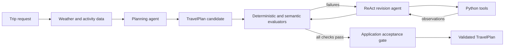

# Travel Planning Agent

An AI planning agent whose output is checked, repaired, and accepted by code:
the language model proposes an itinerary, and Python verifies every fact,
price, and rule before the plan is accepted.

| | |
| --- | --- |
| **Problem** | LLMs produce plausible plans that may invent options, miscalculate costs, or quietly break constraints such as budgets and schedules. |
| **Approach** | Typed data contracts, deterministic and model-based evaluators, and a ReAct revision loop in which the model requests tools while Python executes them and owns the final acceptance gate. |
| **Results** | The accepted plan passed all 7 evaluations, covered every traveler's interests across 3 days, and cost exactly the 130-unit budget after incorporating feedback to schedule at least two activities per day. |
| **Stack** | Python · OpenAI API · Pydantic · ReAct tool use · Chain-of-Thought prompting · LLM-as-a-judge · uv |

## Overview

Given traveler preferences, trip dates, a shared budget, weather forecasts, and
an authoritative activity catalog for a fictional city, the agent produces a
typed `TravelPlan`, checks it against business rules, incorporates traveler
feedback, and accepts the revised plan only after an independent final
evaluation.

The engineering problem is not travel recommendation; it is keeping an LLM
under control inside a decision workflow. The same
proposal → validation → repair → acceptance pattern applies to scheduling,
quoting, procurement, claims review, and any workflow where a model recommends
an action but application code owns the facts and the final decision.

## How it works



1. **Plan.** The model receives the request, weather, activity catalog, and the
   `TravelPlan` schema, and returns JSON that Pydantic validates.
2. **Evaluate.** Seven evaluators check dates, cost arithmetic, catalog
   integrity, interest coverage, budget, weather fit, and feedback.
3. **Revise.** A ReAct agent requests one tool at a time; Python executes it and
   returns the observation, until the plan passes.
4. **Accept.** Python reruns every evaluation independently and rejects any plan
   that fails, regardless of what the model claims.

## Key design decisions

- **The model proposes; code decides.** The LLM drafts plans, makes semantic
  judgments, and requests tools. Python retrieves authoritative data, executes
  functions, does the arithmetic, validates schemas, and owns acceptance.
- **Deterministic checks for facts, model checks for meaning.** Dates, prices,
  catalog records, and budget are verified in code; weather suitability and
  feedback incorporation, which are genuinely semantic, use a constrained LLM
  judge.
- **Typed contracts at every boundary.** Pydantic models keep catalog facts
  separate from the model's reasoning, so plausible prose or partial JSON
  cannot enter downstream logic.
- **Independent acceptance gate.** The final plan is re-evaluated outside the
  revision loop, so a model's claim of success is never taken at face value.

## Results

In the recorded run, the accepted itinerary:

- passed all 7 evaluations, with `success=True` and no failures;
- scheduled 3, 2, and 2 activities across the three days after feedback asked
  for at least two per day; and
- totaled 130 against a 130-unit budget.

## Limitations

- Weather and activity services are mocked for one fictional scenario; there
  is no real search, booking, or payment.
- Weather fit and feedback incorporation are LLM judgments and can vary
  between runs.
- The revision loop parses tool requests from text; native function calling
  with strict schemas would remove that parsing risk.
- There is no dedicated deterministic check for overlapping same-day times.

[docs/architecture.md](docs/architecture.md) covers each of these and the
production hardening that would address them.

## Running locally

Requires Python 3.13, [uv](https://docs.astral.sh/uv/), and an OpenAI API key.

```bash
uv sync --locked
cp .env.example .env          # then set OPENAI_API_KEY
uv run python scripts/validate_notebook.py
```

Select the project environment as the Jupyter kernel and run
`travel_planning.ipynb` from top to bottom. The validator checks the notebook's
structure, syntax, required prompt and tool contracts, and obvious secrets
without making API calls.

## Repository structure

```text
.
├── travel_planning.ipynb           # Complete planning, evaluation, and revision workflow
├── project_lib.py                  # Chat wrapper, mocked weather and activity data, helpers
├── docs/
│   ├── architecture.md             # Design notes, CoT vs. ReAct, production hardening
│   └── requirements-traceability.md  # Requirement-to-cell evidence map
├── scripts/
│   └── validate_notebook.py        # Offline structure and contract checks
├── .env.example
├── pyproject.toml
└── uv.lock
```
