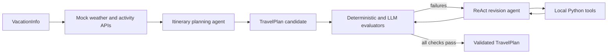

# AgentsVille Trip Planner

AgentsVille Trip Planner is a learning project that demonstrates how a large
language model (LLM) can participate in a constrained business workflow rather
than simply generate free-form travel advice. The system creates an itinerary
from supplied traveler, weather, and activity data, validates the result, and
then revises it in response to traveler feedback.

This repository is based on a Udacity project scaffold. The course supplied the
fictional scenario, notebook structure, support library, mocked data, and core
workflow interfaces. The completed exercise work includes the required
Pydantic fields, itinerary/weather/revision prompts, tool documentation,
constraint logic in those prompts, and parser-compatible output contracts. The
repository cleanup, README, rubric evidence map, and offline validator were
added for a reviewable submission. `project_lib.py` remains attributed support
infrastructure rather than an independently authored framework. The
[public course repository](https://github.com/udacity/cd14526-Effective-Prompting-AgenticAIC1-exercises)
may differ from the downloaded classroom version used here.

## Business problem

The fictional travelers, Yuri and Hiro, are visiting AgentsVille from
2025-06-10 through 2025-06-12 with a budget of 130 currency units. The planner
must produce a machine-readable itinerary that satisfies several constraints at
the same time. It is one shared group itinerary: both companions attend each
selected activity, while the complete set of choices must cover each person's
individual interests.

- cover every trip date;
- select only activities available on the correct date;
- match activities to the travelers' individual interests;
- avoid weather-incompatible outdoor activities unless a suitable backup is
  explicitly available;
- prevent activities on the same day from overlapping;
- keep the exact sum of activity prices within budget; and
- incorporate later feedback requesting at least two activities per day.

The deeper business pattern is transferable. An LLM proposes decisions using
enterprise facts, deterministic and semantic checks validate those decisions,
and a tool-using revision loop repairs failures before the output is accepted.
The same pattern can support scheduling, quoting, claims review, procurement,
and other constrained workflows.

## End-to-end workflow



The workflow has two agent stages:

1. **Initial planning.** The itinerary agent receives a `VacationInfo` object
   in the user message. Weather and activity records are grounded in the system
   prompt. The model returns a JSON object that validates as `TravelPlan`.
2. **Evaluation and revision.** Evaluators report constraint failures. The
   revision agent uses a text-based ReAct protocol to choose one local tool at a
   time, observe its result, update the complete candidate plan, and submit only
   after the candidate passes every configured evaluation.

## Architecture and responsibilities

| Layer | Main responsibilities | What it does not do |
|---|---|---|
| `project_starter.ipynb` | Defines the Pydantic contracts, prompts, evaluators, tool wrappers, ReAct parser/dispatcher, and final validation | It does not provide the underlying mocked data or generic chat transport |
| `project_lib.py` | Provides `ChatAgent`, the Chat Completions wrapper, the interest enum, mocked weather/activity data, and display helpers | It does not decide which ReAct tool to call and does not revise the itinerary |
| LLM | Interprets the request, proposes structured plans, judges semantic weather compatibility, and selects the next tool with arguments | It does not execute Python functions or directly access Python memory |
| Python | Retrieves authoritative data, calculates values, validates schemas and rules, parses tool requests, invokes real functions, records observations, and controls stopping | It does not rely on model prose as proof that a hard constraint passed |

`project_lib.py` is important even though students normally do not edit it. It
is the communication and mocked-data layer. The notebook's
`run_react_cycle()` is the orchestrator: it sends message history to the LLM,
parses the returned `ACTION` JSON, executes the matching Python function, and
adds the result as an `OBSERVATION` for the next model turn.

The key interaction can be summarized in one sentence:

> The LLM proposes a structured tool request; Python parses, executes, and
> returns the result; the LLM uses that observation to choose the next request.

## Data contracts

Pydantic models make the interface between the LLM and Python explicit:

- `VacationInfo` contains travelers, destination, arrival/departure dates, and
  budget.
- `Weather` represents the authoritative forecast for one date.
- `Activity` represents one complete authoritative catalog record.
- `ActivityRecommendation` keeps the source activity separate from the model's
  recommendation reasons.
- `ItineraryDay` groups a date, its weather, and selected recommendations.
- `TravelPlan` is the final machine-validated output containing the city, trip
  dates, exact total cost, and daily itinerary objects.

This prevents downstream code from accepting merely plausible prose. The final
answer must have the exact fields and nested types required by `TravelPlan`.

## Evaluation strategy

The project deliberately combines deterministic checks with two semantic LLM
checks:

| Evaluation | Implementation | Purpose |
|---|---|---|
| Trip dates | Python | Confirms the requested arrival/departure boundaries |
| Total-cost accuracy | Python | Recomputes selected activity prices |
| Activity integrity | Python + mocked API | Detects invented or altered activity records |
| Interest coverage | Python | Confirms traveler interests are represented |
| Budget | Python | Enforces the maximum trip budget |
| Weather compatibility | LLM evaluator | Interprets indoor/outdoor descriptions and backup options |
| Traveler feedback | LLM evaluator | Judges whether the revised plan has at least two activities per day |

A post-ReAct acceptance-gate cell runs the complete evaluation suite again
outside the agent loop. This is an application-side decision rather than a
claim made by the model itself.

## Chain-of-Thought and ReAct

In this course, both terms describe prompting patterns, but they solve different
problems.

| Dimension | Chain-of-Thought (CoT) prompt | ReAct prompt |
|---|---|---|
| Main goal | Improve one response by decomposing a constrained planning task | Solve an iterative task that needs external tools and feedback |
| Course flow | Analyze constraints, then emit one final `TravelPlan` | `THOUGHT -> ACTION -> OBSERVATION`, repeated until accepted |
| External actions | None during the model response | Python executes requested tools between model turns |
| Best fit | Planning, comparison, or calculation from context already supplied | Searching, checking, repairing, and validating against external state |
| Project use | Builds the first itinerary | Revises it after feedback and evaluator failures |

The notebook asks for a concise `ANALYSIS` or `THOUGHT` summary because the
rubric explicitly teaches those text protocols. It does not require an
exhaustive transcript of hidden model reasoning.

### Course pattern versus a modern production pattern

The course implementation is intentionally transparent and educational. A
production implementation would usually move more of the protocol into the API
and application layer.

| Course-compatible pattern used here | Typical modern production pattern |
|---|---|
| The prompt requests visible `THOUGHT:` and `ACTION:` text | The model need not expose private reasoning; instructions focus on goals and constraints |
| Tool names, purposes, and parameters are inserted into the system prompt | Tools are supplied as structured function definitions with JSON Schemas |
| The model writes an action JSON object as ordinary text | The API returns a structured function/tool-call item |
| Python finds `ACTION:` and parses the following text | Python reads the structured tool name and validated arguments directly |
| Prompt instructions tell the model when it may finish | Python also enforces completion gates, such as requiring the exact last-passing plan |

The modern pattern is generally more robust, but replacing the notebook's
text protocol with native function calling would no longer demonstrate the
specific CoT and ReAct concepts required by this assignment.

## Text-based ReAct mechanics

The model sees a response template such as:

````text
THOUGHT:
I need to evaluate the complete candidate before deciding what to revise.

ACTION:
{"tool_name": "run_evals_tool", "arguments": {"travel_plan": {"...": "complete TravelPlan"}}}
````

The placeholders in the prompt are instructions to the model; a developer does
not fill them manually at runtime. The sequence is:

1. `ChatAgent` sends the system prompt, original plan, and message history to
   the LLM.
2. The LLM fills the action object with a tool name and JSON arguments.
3. The synchronous API call returns one ordinary text string to Python.
4. `run_react_cycle()` locates `ACTION:`, parses the JSON, and matches
   `tool_name` against the local function objects in `ALL_TOOLS`.
5. Python calls the function with `tool_fn(**arguments)`.
6. Python adds the function result to history as an `OBSERVATION` user message.
7. The next model call receives that history and selects the next action.

`final_answer_tool` is primarily a protocol-level exit marker in this notebook.
When the orchestrator sees that name, it validates the supplied `final_output`
as `TravelPlan` and returns it, ending the loop.

## Project structure

```text
.
├── project_starter.ipynb          # Completed, output-free submission notebook
├── project_lib.py                 # Udacity support framework and mocked data
├── docs/
│   └── rubric-alignment.md        # Criterion-by-criterion evidence map
├── scripts/
│   └── validate_submission.py     # Offline notebook hygiene and contract checks
├── .env.example                   # Environment-variable template
├── pyproject.toml                 # Reproducible Python dependencies
└── README.md
```

## Setup

This project uses Python 3.13 and `uv` for dependency management.

```bash
uv sync --locked
cp .env.example .env
```

Set `OPENAI_API_KEY` in `.env`. The course environment uses a Vocareum-compatible
endpoint; `OPENAI_BASE_URL` can be changed for another compatible endpoint.

Then select the project environment as the Jupyter kernel and run
`project_starter.ipynb` from top to bottom. LLM calls are stochastic and may use
paid API capacity.

For a deterministic offline repository check:

```bash
uv run python scripts/validate_submission.py
```

## Validation status

The pre-cleanup notebook was run successfully: its saved run produced a revised
plan and the final seven evaluations returned `success=True` with an empty
failure list. Outputs were then removed and the explanatory/prompt wording was
professionally clarified. The exact current, output-free artifact has received
static validation rather than another online end-to-end run. The repository's
offline validator checks cell preservation, Python syntax, cell-specific prompt
contracts, output cleanliness, and obvious secret leakage without making API
calls.

Because LLM behavior is stochastic, an output-free copy cannot itself prove
that every future online run will follow the same path. Re-run the notebook in
an appropriately configured course environment when fresh execution evidence
is required.

## Limitations

- Weather and activity APIs are mocked and cover only the fictional course
  scenario; this system does not perform real bookings.
- The course evaluator suite does not contain a dedicated programmatic
  same-day overlap check. The prompt prohibits overlap, and the displayed plan
  is sorted for readability, but a production system should enforce scheduling
  deterministically.
- The weather and feedback checks use LLM judgments and can be stochastic.
- The ReAct parser relies on a text label and JSON repair; native structured
  tool calling would be safer in production.
- Course support material is identified as such. No additional redistribution
  license is asserted for Udacity-provided content.

## Rubric

The detailed evidence map is in
[`docs/rubric-alignment.md`](docs/rubric-alignment.md). It follows the
[Udacity project rubric](https://learn.udacity.com/nd900?version=1.3.55&partKey=cd14526&lessonKey=17acdfc4-8a19-4448-8235-4beee6d4fc64&project=rubric).
